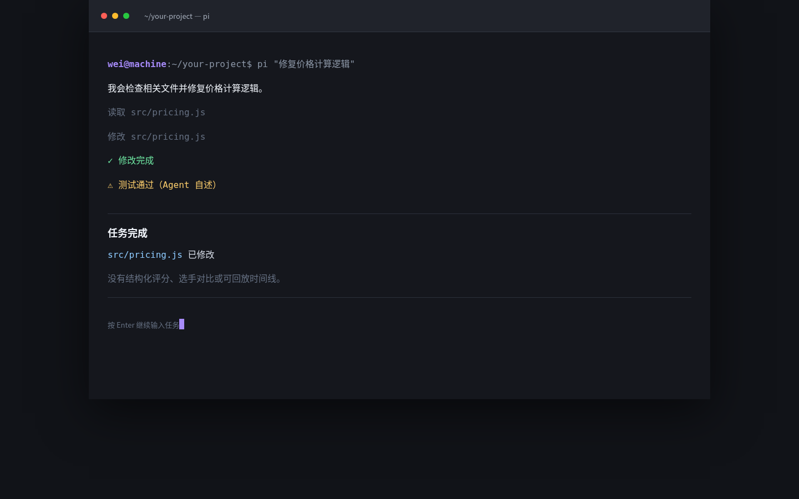
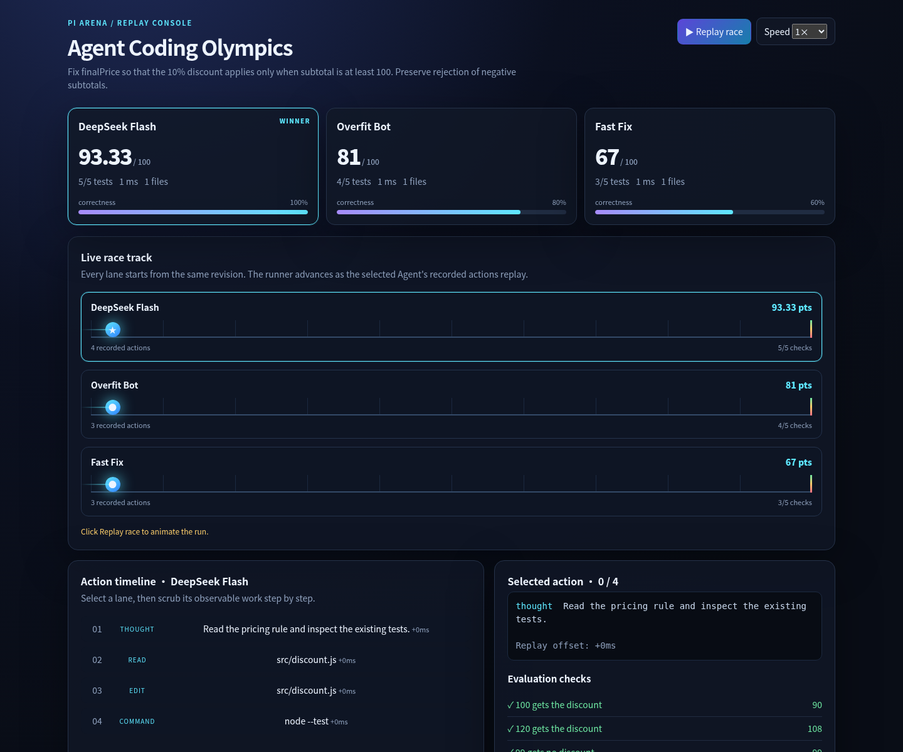

# 含 Pi Arena Skill 与不含 Skill 的对比

这里比较的是“同一个 Pi/模型是否使用 Pi Arena Skill 和评测运行器”，不是比较两个不同模型。为了避免夸大，下面的差异只描述当前实现已经提供的能力。

## 视觉对比

### 不含 Skill：一条普通 Agent 对话



结果通常是一段文字和一个最终 diff。人需要自己确认：Agent 是否真的从干净状态开始、测试是否覆盖边界、是否改了测试、是否能让别人复现。

### 含 Skill：Pi Arena 回放控制台



同一个任务会产生隔离选手、统一评测、分数、操作时间线和可分享的回放页面。点击 **Replay race** 可以逐步观看 Agent 的工作过程。

## 能力差异

| 维度 | 不含 Skill | 含 Pi Arena Skill |
| --- | --- | --- |
| 任务执行 | 一个 Agent 直接修改当前目录 | 每位选手从同一份项目副本开始 |
| 比较多个模型 | 需要人工重复操作 | 一条命令运行多个 Pi RPC 选手 |
| 结果判断 | 依赖 Agent 自己的总结 | 使用用户提供的独立评测模块 |
| 失败定位 | 翻阅聊天记录 | 查看选手时间线和具体检查项 |
| 复现 | 需要手工整理命令和 diff | 输出 `arena.json` 和独立 HTML 回放 |
| 展示效果 | 终端文本 | 赛道动画、积分卡、时间线和测试明细 |
| 人工审批 | 直接看最终代码 | 先看客观测试证据，再审查 diff |

## 一个真实的区别

如果任务要求“满 100 元打九折，99 元不打折”，普通 Agent 可能会说“已修复并测试通过”。Pi Arena 会把这个判断拆成独立检查，并显示类似结果：

```text
✓ 100 元打九折
✗ 99 元不打折   expected: 99   actual: 89.1
```

人工审核者可以直接看到失败边界，而不必相信 Agent 的总结。

## 结论

不含 Skill 的 Pi 适合一次性完成任务；含 Pi Arena Skill 的 Pi 适合**比较、验收、复盘和分享 Agent 工作**。它的价值不是让模型多写几行代码，而是把“模型说完成了”变成有评测、有轨迹、有回放的可检查结果。

当前对比截图来自仓库内置的确定性 Demo，不代表某个模型在所有任务上的长期排名。真实项目应使用自己的任务和评测文件，并保存起始版本、预算和测试命令。
